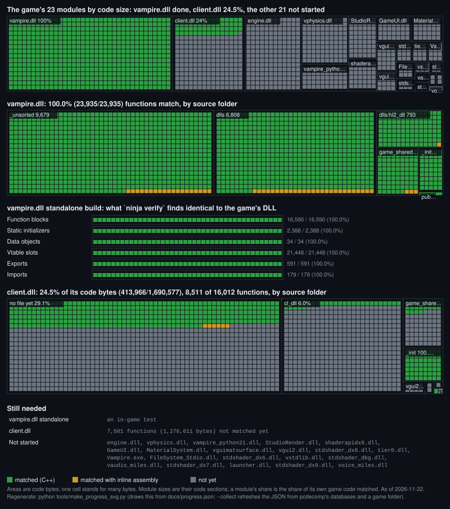

# Vampire: The Masquerade – Bloodlines: `vampire.dll` decompilation

A matching decompilation of `vampire.dll`, the game-code DLL of *Vampire: The Masquerade – Bloodlines*
(Troika Games, 2004), patch 1.2. Each function in `src/` is C++ that Microsoft Visual C++ 6.0 (`/O2 /GR`, the
compiler and flags the game was built with) compiles to the same bytes as the original DLL.

The work was done with **pcdecomp**, a matching-decompilation tool for 32-bit Windows games. pcdecomp compiles a
function with the game's own compiler, compares it with the original byte for byte, and saves it only when the two are
identical. The functions were written by AI agents working through pcdecomp, by hand, and by pcdecomp's own
automatic passes (machine drafts, copies of already matched twin functions).

## Status (2026-11-23)



The picture is drawn by `tools/make_progress_svg.py` from `docs/progress.json` (numbers of 2026-11-23). To redraw
it: `python tools/make_progress_svg.py`; with `--collect --client <client project> --game <game folder>` it first
reads the numbers again from pcdecomp's databases and the game's files.

### `vampire.dll`: every function matches

| | Functions | Code bytes |
|---|---:|---:|
| Game code, matched as C++ | 23,800 (99.44%) | 2,958,007 (97.00%) |
| Game code, matched with inline assembly (counted apart) | 135 (0.56%) | 91,418 (3.00%) |
| **Total game code** | **23,935 (100%)** | **3,049,425 (100%)** |

The count leaves out 17,503 entries that are not the game's own code: 16,468 incremental-link jump stubs and 1,035
C runtime and helper routines (143,448 bytes in all).

`src/` holds 18,978 written blocks: 16,590 functions and 2,388 static initializers. The other 4,957 matched
functions (103,058 bytes) are code the compiler emits from those blocks for static initialization: 2,389 construct
functions, 1,117 `atexit` registrations, 1,117 destroy functions, 333 destroys of function-local statics and 1
initializer entry. Each one matched as part of the block it comes from.

The data is in the sources as well: initialized and constant data in `src/_data/`, zero-initialized globals in
`src/_bss/`, static initializers in `src/_init/`.

**Linking:**
- *Hybrid build*: the original DLL with the compiled functions linked in. It loads and plays in the game.
- *Standalone build* (2026-11-22): `ninja` builds a new `build/vampire.dll` from the sources (see
  [Building](#building)), and `ninja verify` compares it with the original:
  - identical: all 16,590 function blocks in `src/`, all 2,388 static initializers and all 34 data objects;
  - checked: 282 vtables (21,448 slots, every one filled by the compiler), 591 exports (the 32 SafeDisc data
    tables among them) and 179 imports;
  - no difference is left: `config/known_differences.txt` and `config/vtable_patches.txt` are empty (2026-11-23);
  - `ninja ownership` finds what makes each byte of the original file: all but 668 of its 7,860,281 bytes (three
    spots of compiler thunks and one 324-byte block of `.data`).

  In the game (2026-11-23), the standalone DLL in place of the original loaded a map and was played for 150
  seconds (two Hollywood areas, saving, the pause menu) with no crash. It is not yet the same file byte for byte:
  its layout (where each function and table sits, and the padding between them) differs from the original's.

### The rest of the game

| Part | State |
|---|---|
| `client.dll` (client game code) | In progress in a separate project: 11,280 of 16,013 functions (70.4%), 494,254 of 1,690,578 code bytes (29.2%) as of 2026-11-23 |
| `GameUI.dll`, `vampire_python21.dll` | Not started |
| Engine and its modules (`engine.dll`, `launcher.dll`, `materialsystem.dll`, `studiorender.dll`, `shaderapidx9.dll`, `stdshader_*.dll`, `vgui2.dll`, `vguimatsurface.dll`, `vphysics.dll`, `vstdlib.dll`, `tier0.dll`, `filesystem_stdio.dll`, `vaudio_miles.dll`, `voice_miles.dll`), `Vampire.exe` | Not started |
| Third-party libraries (Miles, Bink, zlib, Microsoft runtime) | Out of scope |

## What is in this repository

| Path | Contents |
|---|---|
| `src/` | The matched functions in the game's source files: named by the DLL's own strings, or guessed from the Source SDK's server project (each file's header says which); the rest by class (`src/_unsorted/`); plus data templates, globals and static initializers |
| `include/` | The shared headers: the game's classes, recovered from its RTTI, vtables and code |
| `configure.py`, `tools/` | The build: writes `build.ninja`, runs VC6, fixes up and links the objects, verifies the result ([how it works](docs/building.md)) |
| `config/` | The build's tables: block list, aliases, fix-ups, .bss layout, import lists, known differences |
| `orig/` | Where your own `vampire.dll` goes (git-ignored) |
| `symbols.txt` | Every address with its symbol name |
| `project.toml` | The pcdecomp project settings (compiler flags, prelude, agent settings) |
| `docs/` | How the build works ([building.md](docs/building.md)); research notes: VC6 register-allocation rules, the standalone-link work |
| `CLAUDE.md` | The working guide the agents followed: VC6 code-generation idioms that decide a match |
| `phase0/` | The first experiments that tested whether matching was possible |
| `LICENSE` | CC0 1.0 Universal (see [License](#license-cc0-10)) |

**No game files are included.** To build or check anything you need your own legally obtained copy of the game:
`vampire.dll` from patch 1.2 (SHA-1 `3fe64bc0d9d7eca64976adc668617ca2814e5e4a`). You also need Visual C++ 6.0;
the game was built with VC6 build 9044. The build below needs nothing else. To match new functions with pcdecomp
itself, set `binary`, `cl` and `vcvars` in `project.toml` to the places of these files on your machine.
pcdecomp's database (`project.db`) and its cache are not part of the repository.

## Building

You need:
- Windows;
- Python 3.11 or later;
- ninja (`pip install ninja`, or any ninja on PATH);
- Visual C++ 6.0 with the Processor Pack (its `ml.exe` 6.15 assembles the data templates);
- your own `vampire.dll` (patch 1.2), from the game's `Vampire\dlls\` folder.

```
git clone https://github.com/otonomy/vampire-decomp.git
cd vampire-decomp
copy "<game folder>\Vampire\dlls\vampire.dll" orig\
python configure.py --vc6 "C:\Program Files (x86)\Microsoft Visual Studio"
ninja
ninja verify
```

- Clone into a folder whose path is shorter than about 80 characters. Some file names in `src/_unsorted/` are up
  to 173 characters long, and Windows limits a whole path to 260; with a longer folder path, git stops with
  "Filename too long".
- `--vc6` is the folder that holds `VC98` (with `VC98\BIN\CL.EXE`). Without it, configure.py uses `%VC6_DIR%`,
  then the installer's default places.
- `--orig FILE` takes a copy of `vampire.dll` kept somewhere else instead of `orig\vampire.dll`.
- `ninja` writes `build\vampire.dll` and `build\vampire.map`. The first build compiles about 19,000 objects (about
  20 minutes on 12 threads); later builds recompile only what changed, including every block that includes a
  changed header.
- [docs/building.md](docs/building.md) explains each step and each file in `config/`.

## Verifying

`ninja verify` compares `build\vampire.dll` with your `orig\vampire.dll`:
- every function block, initializer and data object, byte for byte, with every relocation pointing at the
  counterpart of the game's target, including the data each block defines (RTTI records, tables, statics);
- every vtable slot;
- the static-initializer table, the exports and the imports;
- that every block in `src/` is listed in `config/blocks.txt` (an unlisted one is built but not checked).

It prints a summary, writes `build\report.json` and exits 0 when every difference it finds is listed, with its
reason, in `config/known_differences.txt`; today that list is empty, so any difference fails the check.
`python -m tools.verify --function 0x<address>` shows one function's
bytes next to the game's (disassembled when `pip install capstone` is installed).

`ninja ownership` gives every byte of `orig\vampire.dll` an owner (code, data, vtables, library code, linker
tables, padding...), writes `build\ownership.json` and exits 1 while any byte has none.

## Legal

This is an unofficial fan project for study and preservation. It is not affiliated with or endorsed by the owners of
the game. *Vampire: The Masquerade – Bloodlines* was developed by Troika Games and published by Activision.
*Vampire: The Masquerade* and *World of Darkness* are trademarks of Paradox Interactive. The game runs on Valve's
Source engine. No game assets or binaries are distributed here.

### License: CC0 1.0

The contributors dedicate their own work in this repository to the public domain under CC0 1.0 Universal (full
text in `LICENSE`). You may use, change and share that work for any purpose, without asking and without giving credit.
By opening a pull request you dedicate your contribution under the same terms.

The dedication is limited to the contributors' own work. It gives no rights in the game, its code, its data or its
assets, in the Source engine, or in any trademark; those remain with their owners. Building or checking anything here
needs your own legally obtained copy of the game. If a rights holder asks for material to be removed, open an issue and
it will be taken down.
